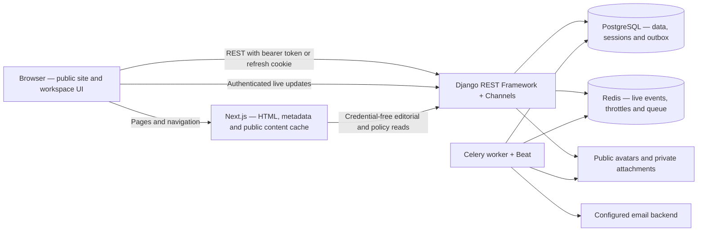

# TeamBoard architecture

Public HTML uses the language in the URL and the selected theme. The public demand cache keys the anonymous article and listing payloads by language and query. Workspace UI loads account-scoped data after session restoration. The backend verifies current session and workspace or project access for protected reads and writes. Private attachments are fetched through authorized endpoints.

The access token lasts 15 minutes. Account endpoints rotate the HTTP-only refresh cookie, whose session expires after seven days by default. Django persists session and blacklist state in PostgreSQL. Redis carries live events and enforces rate limits on configured account, creation and public form endpoints. Email and cleanup work enter a durable PostgreSQL outbox, which Celery processes asynchronously. [Worker delivery and recovery](infrastructure.md#transactional-outbox-and-guarantees)

## API contract

- Business endpoints are versioned under `/api/v1/`. Swagger is at `/api/docs/`, ReDoc at `/api/redoc/`, and the OpenAPI document at `/api/schema/`. The [checked-in schema](../config/schema.yml) records response shapes and accepted parameters.
- Standard resource pages receive `count`, `next`, `previous` and `results`. Use the returned links to navigate. Sitemap entries use cursor continuation. The session and direct-chat routes also support bounded legacy arrays, documented in the [README](../README.md#api-and-permissions).
- Filtering is resource-specific. Tasks accept search text, status, priority, assignee, due date filters and allowlisted ordering. Notifications filter by read state. Blogs select language and page. Calendar and reports expose their own time ranges and filters in OpenAPI. Server ordering includes stable tie-breakers where lists need repeatable pagination.
- API-wide errors use a JSON `detail` message. Field validation uses field names with lists of messages, including `non_field_errors` for cross-field rules. Clients can use HTTP status, `WWW-Authenticate` on authentication errors and `Retry-After` on throttling responses. A successful deletion may return an empty 204.
- The SMTP backend uses a 15-second I/O timeout by default. Public server reads have bounded deadlines and session restoration has its own deadline. The project has no payments or SMS integration.

## Runtime settings

Keep local credential values in an ignored environment file. The [example](../.env.example) lists the standard development values and [deployment guide](infrastructure.md#deployment) describes how the services fit together.

| Variables | Purpose |
| --- | --- |
| `SECRET_KEY`, `DEBUG`, `ALLOWED_HOSTS` | Django signing key, debug behavior and accepted HTTP hosts. |
| `POSTGRES_DB`, `POSTGRES_USER`, `POSTGRES_PASSWORD`, `POSTGRES_HOST`, `POSTGRES_PORT` | Database connection and credentials. Compose sets the internal host and port for application services. |
| `FRONTEND_URL` | Browser origin used by CORS and account email links. |
| `NEXT_PUBLIC_API_URL`, `NEXT_PUBLIC_SITE_URL` | Browser-reachable API origin and public canonical site origin. Set them at frontend build time. |
| `WEBSITE_API_URL` | Server-reachable Django origin for credential-free public reads. |
| `REDIS_URL`, `REDIS_CACHE_URL`, `CELERY_BROKER_URL` | Channels transport, throttle cache and task broker connection strings. |
| `CHANNEL_REDIS_PREFIX`, `CACHE_KEY_PREFIX` | Environment-specific key prefixes for live events and throttling. |
| `EMAIL_BACKEND`, `DEFAULT_FROM_EMAIL`, `EMAIL_TIMEOUT` | Email implementation, sender address and SMTP deadline in seconds. |
| `EMAIL_HOST`, `EMAIL_PORT`, `EMAIL_HOST_USER`, `EMAIL_HOST_PASSWORD`, `EMAIL_USE_TLS`, `EMAIL_USE_SSL` | SMTP provider connection and security settings. |
| `EMAIL_FILE_PATH`, `CELERY_TASK_ALWAYS_EAGER` | Test or diagnostic overrides for file-based emails and in-process task execution. |
| `REFRESH_TOKEN_COOKIE_NAME`, `REFRESH_TOKEN_COOKIE_PATH`, `REFRESH_TOKEN_COOKIE_SECURE`, `REFRESH_TOKEN_COOKIE_SAMESITE` | Refresh-cookie transport policy. |
| `WEBSITE_CONTACT_RETENTION_DAYS` | Retention period used by public privacy copy and the contact cleanup task. |
| `COMMENT_ATTACHMENT_ROOT`, `CHAT_ATTACHMENT_ROOT` | Private filesystem roots for the two attachment stores. |
| `APP_ENV_FILE`, `BACKEND_PORT`, `REDIS_PORT` | Compose environment file and host-side port overrides. |
| `IRANSANSX_WEBFONT`, `NEXT_PUBLIC_TEAMBOARD_PROFILE_UI` | Optional Persian-font override and React profiling-build flag. |
| `RUN_REDIS_TESTS`, `E2E_PASSWORD`, `E2E_PYTHON`, `E2E_FRONTEND_PORT`, `E2E_BACKEND_PORT`, `E2E_BROWSER_CHANNEL` | Test-only controls for Redis integration, browser fixtures, interpreter, ports and browser channel. |

For a release, review the existing [deployment guide](infrastructure.md#deployment) and [operation and recovery procedures](infrastructure.md#verification-and-recovery).
