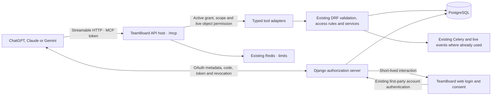

# TeamBoard remote MCP design and delivery plan

Baseline reviewed on 2026-11-26 at `a52837b04a02fb73584e13aa70dfa39d3b409400`. The local checkout and GitHub `main` matched. This document is a design and implementation checklist. Client results are marked separately from documented capabilities.

## Architecture

Use the official MIT-licensed Python MCP SDK stable 2.x as a candidate for the wire protocol. Start with Streamable HTTP and verify protocol `2025-11-25` compatibility because SDK clients and hosted AI surfaces can negotiate differently. Also test the SDK's modern `2026-07-28` mode separately. Use the SDK's stateless legacy mode where compatible. Leave legacy multi-endpoint SSE and optional protocol extensions out of the initial surface. [Protocol release](https://blog.modelcontextprotocol.io/posts/2026-07-28/) · [Python SDK](https://github.com/modelcontextprotocol/python-sdk)

The canonical transport lives at `https://<api-origin>/mcp`. The bilingual information pages live at `https://<website-origin>/mcp` and `/fa/mcp`. An exact ASGI path mount can preserve all Django HTTP and Channels WebSocket routes. Prove the SDK mount and startup behavior on the existing Daphne stack before choosing a lifecycle adapter. The official deployment enables the integration explicitly. Development uses disposable loopback settings and credentials. Advertised issuer and resource URLs come from validated configuration. No public domains, account entitlements or infrastructure are inferred here.

## Authorization and operations

1. Use Django OAuth Toolkit 3.4.x as the candidate authorization server, with OAuthLib behind it. Verify package compatibility and the actual Authorization Code, PKCE, metadata, RFC 8707 audience binding, exact redirects, refresh rotation and revocation behavior before adopting configuration and persistence. Set the authorization-code flow to `S256` only and require PKCE. Disable password, implicit and client-credentials grants for MCP. Advertise the capabilities that pass transport and conformance tests. [Toolkit MCP support](https://django-oauth-toolkit.readthedocs.io/en/stable/index.html#mcp-authorization) · [OAuth settings](https://django-oauth-toolkit.readthedocs.io/en/stable/settings.html)
2. Publish RFC 8414 authorization-server and RFC 9728 protected-resource metadata. MCP `401` responses use a `WWW-Authenticate` challenge with the resource metadata URL. Authorization and token exchange bind the canonical MCP resource, exact redirect URI, client, scopes and verifier to a short-lived single-use code. Check issuer, resource, active connection, client and user on each call. Evaluate token-at-rest storage against the library's actual model before exposing the server. Rotate refresh tokens with replay protection and keep credentials out of logs and tool responses.
3. The existing frontend access token is held in React state. Its HTTP-only refresh cookie is scoped to `/api/v1/accounts/`. The authorization endpoint therefore creates a short-lived opaque interaction after validating the client request, then sends the browser to TeamBoard to authenticate and see the exact client and permissions. A first-party consent API uses the existing authenticated account and binds the interaction to that browser and user. Redirect to a validated callback with the OAuth code and the client's state after consent. Use fixed-origin return paths, CSRF protections appropriate to the browser boundary, no-store responses and a restrictive referrer policy. The AI host receives only MCP credentials.
4. Support pre-registered clients and tested vendor CIMD identities. Constrain outbound metadata resolution to approved HTTPS identities, strict destination validation, short deadlines and response-size limits. Google documents an automatic DCR path, so implement a bounded compatibility option with approved callback policies, validation and rate limits. Public registrants cannot choose trusted branding, privileged scopes or arbitrary callbacks. Development-only Inspector localhost callbacks follow the native OAuth loopback rules. [Toolkit CIMD](https://django-oauth-toolkit.readthedocs.io/en/stable/cimd.html) · [Google OAuth guide](https://developers.google.com/connected-apps/mcp/oauth)
5. Separate `teamboard.read`, `teamboard.write` and `teamboard.sensitive`. Consent defaults to minimum access. Sensitive scope only permits requesting an approval. TeamBoard shows the exact target and proposed changes on its own page and confirms as the signed-in human. Execution rechecks live permissions inside the transaction and consumes the user-bound, short-lived approval once. AI text, MCP client info and UI hints are never authority to approve a mutation.
6. Use a first-party connections page to list client identity, scopes and connection dates and to revoke one or all owned grants. Revocation and account security events invalidate related token families. Last-used timestamps should be coarse or sampled if needed. Use PostgreSQL for grants, approvals and deduplication. Redis limits MCP requests and client registration with a deny-on-unavailable policy. Redact bearer tokens, cookies, authorization codes and bodies from operational logs.
7. Give supported write tools an idempotency key. Scope it to the actor, connection and tool. Compare canonical validated inputs, serialize concurrent retries and commit the receipt and mutation together. Recheck permissions before replaying a response and store only the minimum outcome data. When access has changed, deny the replay. Existing side effects continue through the existing service, transaction and outbox paths.
8. Use explicit input and output allowlists. IDs come from the relevant authorized results, with integer user IDs, UUID records and workspace slugs kept distinct. Bound pagination, report windows, request time, body size and response size. Keep user-generated content in data fields. Unknown endpoints, arbitrary URLs and unrestricted query tools have no place in the tool registry. Transport/authentication errors remain HTTP/JSON-RPC errors. Tool validation, permission and bounded retry results use explicit error codes and the SDK's tool-result mechanism.

## Coverage from current APIs

The checked-in schema contains 70 paths and 94 operations. The rows below map business operations, rather than publish each REST method as an independent tool. All rows are proposed.

| Area | Read-only surface | Write surface | Approval or web-only | Reuse and current gaps |
| --- | --- | --- | --- | --- |
| Accounts | `teamboard_whoami` with a small profile allowlist. Evaluate a minimal session summary as opt-in. | — | Password, recovery, credential and web-session management stay in account settings. | `config/accounts/authentication.py`, account views and serializers. Omit IP, user agent and opaque session IDs from any summary. |
| Workspaces | List, get, authorized member and role lookup. Invitation status as allowed. | Create and update as authorized. | Invitations and membership changes need approval. Ownership transfer, leave and workspace deletion stay in the web flow initially. | `config/workspaces/access.py`, `services.py` and membership views. Invitation tokens are excluded. |
| Projects | Scoped list, detail, members and effective access. | Create and update. | Member or role changes and deletion require approval or the web flow. | `config/projects/access.py` and `services.py`. Search does not currently exist in the REST list. Add a shared bounded filter only if confirmed necessary. Effective manager access can differ from a serialized membership role. |
| Tasks | Project-scoped list, search, filters and details. Dashboard due, overdue and personal previews. | Create, update, assign and move within the current board. | Confirm task deletion in TeamBoard. | `config/tasks/access.py` and `services.py`. A global task search, full personal-day list and bulk mutation are absent. Do not represent a dashboard preview as a complete list. |
| Comments | Paged thread and reply context. | Post, reply or edit under current author policy. Mention targets are resolved by the backend. | Confirm destructive operations when exposed. | `config/comments/access.py` and `services.py`. Keep file access out of comment text results. |
| Chats | Authorized conversations, bounded recent messages, unread counts. | Start direct chat, send or reply, mark read. | Deletion and broader file features stay in web initially. | `config/chats/access.py`, `services.py`, `unread.py`. Add a pure project-chat lookup when needed because an existing GET can create a conversation. AI can summarize authorized results. |
| Notifications | Read/unread filter, unread count and safe row details. | Mark one as read. Evaluate a separately annotated mark-all operation. | Invitation acceptance follows the membership flow. | `config/notifications/access.py` and `services.py`. No standalone notification detail or atomic mark-selected API exists today. |
| Calendars | Workspace and project timelines, bounded time windows and deadlines. | Create and edit project events. | Confirm deletion when exposed. | `config/calendars/access.py`, `services.py` and `timeline.py`. Preserve timezone-aware instants, exclusive ranges and all-day civil dates. |
| Reminders | Private task reminders for the authenticated account. | Create, edit or cancel with the existing permission rules. | Approval policy covers destructive cases where cancellation cannot be safely reversed. | `config/tasks/reminders.py` and reminder serializers. Today's GET can reconcile derived state. Prove a pure read before marking the tool read-only. Omit internal error text. |
| Dashboard and reports | Workspace/project overview, workload, history and comparisons with output caps. | — | CSV export remains the authenticated web download initially. | `config/dashboard/services.py`, `config/reports/services.py` and `analytics.py`. |
| Website and files | Published blog list/detail and approved attachment metadata where useful. | — | Admin, unpublished content, private download and cross-client upload remain in TeamBoard initially. | `config/website/services.py` and authenticated comment/chat download views. Exclude storage keys, private URLs and arbitrary file or URL fetching. |

Extract the smallest existing view-only policy into a shared function when necessary. Keep existing REST callers and checks intact. Use only fixed, registered tool adapters and do not invoke production code through DRF test authentication. Mark tool behaviors with supported MCP annotations after checking real side effects. Tool outputs will include concise structured data and a JSON text representation for clients that consume text only. [Google result format and static catalogs](https://developers.google.com/connected-apps/mcp/server-optimization)

## Platform compatibility

The matrix describes official product documentation checked on 2026-11-26. No live TeamBoard connection with a vendor account has been verified.

| Surface | Documented user access and actions | Connection and constraints | Local or live test |
| --- | --- | --- | --- |
| ChatGPT web | Business and Enterprise/Edu document full custom MCP, subject to workspace admin policy. Pro documents read/fetch. Deep Research uses read tools. Free or Plus access to this private connection is unconfirmed. | Public HTTPS, OAuth discovery, PKCE and CIMD/DCR/pre-registered options. Confirm exact negotiated revision and tool catalog in the live client. Workspace app snapshots may need review on schema changes. Directory publication is a separate review. | Local SDK/Inspector first. Then eligible web workspace and approved HTTPS endpoint. [ChatGPT custom MCP](https://help.openai.com/en/articles/12584461-connecting-custom-mcp-servers-in-chatgpt) · [OpenAI auth](https://developers.openai.com/plugins/build/auth) · [Submission](https://developers.openai.com/plugins/deploy/submission) |
| Claude remote connectors | Free allows one custom connector. Paid and managed plans support custom remote connectors under plan and admin rules. Read/write tools are documented. Custom connector file transfer is unavailable. Iran is absent from Claude's published supported-region list. | Public HTTPS port 443, Streamable HTTP, OAuth PKCE and published client identity, DCR or manual registration. Validate document-supported `2025-11-25` and callback behavior. The published connector guide gives response-size/time limits. | Eligible Claude account and approved HTTPS origin. [User guide](https://support.claude.com/en/articles/11175166-get-started-with-custom-connectors-using-remote-mcp) · [Build](https://claude.com/docs/connectors/building) · [Auth](https://claude.com/docs/connectors/building/authentication) · [Regions](https://support.claude.com/en/articles/8461763-where-can-i-access-claude) |
| Gemini Apps | Custom URL entry in web setup for eligible US adults, personal Google accounts, enabled History and English. Connected tools can then be used on the documented web/mobile surfaces. Validate confirmation behavior for write tools. | Streamable HTTP to `2025-11-25`; optional GET stream can be `405`. Automatic OAuth setup uses DCR on the documented path, with manually registered credentials as an alternative. JSON text is required and published schemas are snapshotted. | Approved HTTPS origin and eligible account; use Developer Mode to inspect tool inputs, outputs and authentication. [User eligibility](https://support.google.com/gemini/answer/17209137) · [Developer Mode](https://developers.google.com/connected-apps/mcp/dev-mode/usage) · [Integration standards](https://developers.google.com/connected-apps/mcp/server-optimization) |
| Gemini API and developer tools | Interactions API remote MCP is an app-developer feature with model-specific availability. Gemini CLI has its own client configuration and OAuth path. | Streamable HTTP configuration and supported model, credential and host rules vary by product. An SDK or CLI result does not verify the Gemini Apps surface. | Use API/CLI test credentials only if available. [Interactions API](https://aistudio.google.com/docs/function-calling#mcp) · [Gemini CLI](https://geminicli.com/docs/tools/mcp-server/) |

Publish standalone guides for each surface only with available commands, account scope, connection status, tested behavior and known limits. Check current provider region and account policy before enabling a live test. Defer unsupported file transport and interactive adjunct features until a verified client path exists.

## Implementation order and verification gates

| Stage | Files or boundaries | Gate before extending |
| --- | --- | --- |
| 0. Baseline and dependency evaluation | `docs/mcp-design.md`, isolated files under `artifacts/` | Match GitHub SHA, audit stack/routes, verify documented client capabilities, resolve candidate SDK and OAuth dependencies against the actual requirements. |
| 1. Protected vertical slice | New `config/ai_integrations/` app, opt-in `config/config/mcp_local_*.py` runner and settings, `requirements-mcp.txt`, first-party consent route | Migrate disposable PostgreSQL. Prove discovery, account consent, code+PKCE, refresh, revocation, bounded account and Workspace reads, legacy/modern protocol behavior, existing HTTP/WS routing and denial for missing/wrong credentials. |
| 2. Product tools | `config/ai_integrations/tools/` plus small shared app operations where necessary and app-specific tests | Demonstrate role and workspace parity with REST, reauthorization after membership changes, bounded reads, validation, timezones, transactional/idempotent writes and live side effects through existing services. Cover Persian and English scenario inputs. |
| 3. Sensitive operations and connection UI | First-party consent/approval endpoints and `client/src/app/dashboard/` with bilingual UI and E2E | Verify ownership, secure human approval, explicit payload binding, expiry, replay, concurrent confirmation, account deactivation and revoke-all. |
| 4. Public pages and integration verification | `client/src/app/(public)/mcp/`, `client/src/app/(localized)/fa/mcp/`, existing public navigation/sitemap/metadata, provider guides | Verify mobile/desktop, keyboard, RTL and both themes, wire schema parity, simulated client failures and Inspector. Collect per-provider live outcomes only where an eligible account and approved HTTPS test endpoint exist. |
| 5. Release verification | Existing CI and README, contributor/security/release documentation as approved | Run complete regression, dependency and secret/license checks. Production operations, backup/restore, domain/SMTP, provider submission and online smoke tests wait for the deployment phase. Commit and push require explicit maintainer approval after results. |

Expected local gates include `python manage.py check`, `python manage.py makemigrations --check --dry-run`, structural OpenAPI validation, `python -m pytest -q` against PostgreSQL/Redis, `npm run lint`, `npm run typecheck`, `npm run test:coverage`, `npm run build` and `npm run test:e2e`. Stage 1 exercises the protocol over HTTP in the Django and browser suites. Stage 4 adds the Inspector smoke command with the installed client version and explicit test origin. Inspect p95 and query counts for representative authorized reads and mutations. Test limits and outages with disposable services. Secrets, vendor credentials, production endpoints and commercial fonts stay outside release artifacts. The application code continues under MIT, with Vazirmatn available as a licensed-font-independent Persian fallback.

## Stage 0 verification on 2026-11-27

- An isolated dependency resolution succeeded with the repository's existing requirements and Python 3.14, Django 5.2.18, `mcp==2.3.0` (MIT) and `django-oauth-toolkit==3.4.1` (BSD). The isolated installed package scan reported no known vulnerabilities at the time of the check. [Toolkit license and Django compatibility](https://github.com/django-oauth/django-oauth-toolkit)
- A disposable Django/SQLite fixture verified authorization-server and resource discovery, rejection of consent without CSRF, S256, issuer and state, audience persistence, authorization-code single use, digest-only access/refresh storage, rotation and revocation. Use an explicit canonical issuer: the first fixture using inferred origins returned different issuers for root discovery and a prefixed authorization mount. The token storage gate is `COMPLIANT_BCP_RFC9700_TOKEN_STORAGE`. TeamBoard account consent and PostgreSQL integration remain stage 1 work.
- SDK HTTP-frame tests passed stateless tool calls on `2025-11-25` and `2026-07-28` and rejected missing or wrong-audience tokens. These fixtures exercise protocol behavior. They do not establish compatibility with hosted clients or Inspector.
- The SDK mount requires the session manager lifespan even in stateless mode. A direct mount under the current Daphne runner returned HTTP 500 in the loopback probe. A single Uvicorn worker with lifespan and WebSocket support served the same SDK fixture, the existing TeamBoard policy endpoint and the expected unauthorized WebSocket denial. The proposed local stage 1 runner is therefore Uvicorn for the MCP-enabled test path. The existing Daphne deployment remains untouched. Prove authenticated WebSocket traffic, concurrent tool calls and the standard application suites before making a later deployment decision. [SDK mount lifecycle](https://py.sdk.modelcontextprotocol.io/migration/#mounting-in-an-existing-starlette-app)

The scratch probes and dependency reports are under ignored `artifacts/mcp-preflight/`. No TeamBoard application endpoint or database migration has been enabled by this stage.

## Local implementation checkpoint on 2026-11-27

The opt-in Uvicorn entry point serves OAuth discovery, authorization, token renewal, revocation and Streamable HTTP over loopback. The [local guide](mcp-local.md) lists the fourteen current read tools and exact setup and test commands. The wire tests cover both protocol versions, blocked cross-workspace access, revoked membership, single-consumption authorization codes and an authenticated WebSocket forwarded to the existing Django application. PostgreSQL query-count checks cover project listing, single-project task listing and workspace-scoped task listing with different page sizes.

The later implementation adds the calendar, reminder, report, account, roster, blog and authorized attachment reads. The write scope uses the same domain services and transactional retry receipts, and task deletion requires a user decision in TeamBoard. The bilingual public pages and account connection management are available in the app. The HTTPS settings profile provides callback-allowlisted dynamic registration with public or confidential clients. The [client guides](mcp-clients.md) distinguish the local verification from the pending hosted tests and deployment.
